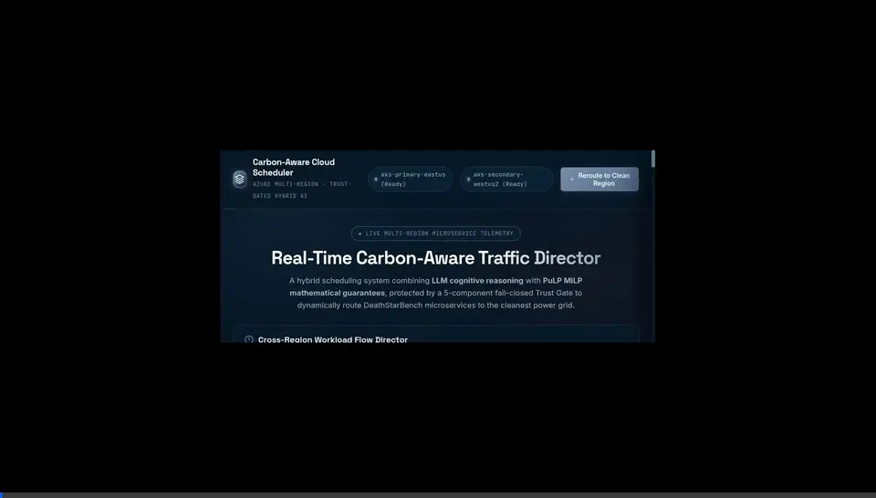

# Carbon-Aware Cloud Optimization: Multi-Region Trust-Gated Scheduler

This scheduler chooses a region and start time for a DeathStarBench benchmark session on two pre-provisioned Azure Kubernetes Service (AKS) clusters. A local Llama-3 proposer suggests an action; deterministic admission checks compare it with an exact feasible-candidate reference. Electricity Maps supplies live average carbon intensity, a manifest-derived service inventory supplies permitted services, and every decision is recorded with input hashes. The paper evaluates the checks, their limitations and their cost.

---

## Demonstration Walkthrough



*Figure 1: Dashboard demonstration. The animated topology, reasoning text and legacy five-component score are presentation features; the experiment receipts are the evidence for measured scheduler behaviour.*

Direct video link: [Download Full-Resolution Demonstration (MP4)](docs/assets/dashboard_demo.mp4)

---

## Executive Summary

The evaluated default is gate **v2.1**. It checks proposal format, identifiers,
window and availability; catalog-based model feasibility; carbon-data age and
recorded zone identity; and modelled carbon regret within 5% of the exact
reference. If a proposal fails, the reference decides. If input checks fail,
the scheduler uses sufficiently recent last-known-good data or starts no session.

The configured score rule, R2, additionally requires RAGAS faithfulness and
context precision to average at least 0.6. Context precision does not receive
the proposal. Experiments recommend the hard checks alone (R0) for this
modelled contract; the evaluated runs and shipped default still use R2.

Both clusters remain provisioned whichever region is selected. Reported
intensity differences describe placement decisions, rather than measured
reductions in total cluster emissions.

---

## End-to-End System Architecture

```mermaid
flowchart TD
    subgraph S1 [1. Ingestion Layer]
        EM[Electricity Maps API<br/>Real-Time + 24h Forecast]
        Neo4j[Service Graph from Manifests<br/>27 Deployments/Services]
        Qdrant[Qdrant Vector DB<br/>Temporal Filter: event_time <= as_of]
    end

    subgraph S2 [2. Context Fusion]
        RAG[Hybrid RAG Context Assembler<br/>Retrieves Snapshot & Service Inventory]
    end

    subgraph S3 [3. LangGraph Workflow]
        LG[LangGraph StateGraph Engine]
        Ollama[Local Ollama Runtime<br/>Llama-3 8B Proposer]
        Schema[Pydantic v2 ActionProposal<br/>Strict Schema: extra='forbid']
    end

    subgraph S4 [4. Dual-Layer Trust Gate]
        Rails{Proposal Checks<br/>Schema, IDs, Model Feasibility,<br/>Window, Availability, Regret}
        Scorer{R2 Evidence Score<br/>(Faithfulness + Context Precision)/2 >= 0.60}
    end

    subgraph S5 [5. Fallback Engine]
        MILP[PuLP / COIN-OR CBC Solver<br/>Branch-and-Cut Optimization<br/>Min Carbon Subject to P95 <= 500ms]
    end

    subgraph S6 [6. Kubernetes Actuation & Verification]
        AKS1[aks-primary-eastus2<br/>Standard_D2as_v7, 2 Nodes]
        AKS2[aks-secondary-westus2<br/>Standard_D2as_v7, 2 Nodes]
        WRK2[wrk2 HTTP Load Generator<br/>compose-post.lua, 10 RPS, 60s]
    end

    subgraph S7 [7. Observability & Audit Ledger]
        OTel[OpenTelemetry Distributed Spans]
        Ledger[(Decision Ledger<br/>cycles.jsonl & summary.csv)]
        UI[Glassmorphism Dashboard<br/>Port 8080]
    end

    EM --> Input{Input Checks<br/>Age & Recorded Zone Identity}
    Input -- Passed --> RAG
    Input -- Failed --> Recovery[Last-Known-Good Reference<br/>or Hold with Alert]
    Neo4j --> RAG
    Qdrant --> RAG
    RAG --> LG
    LG <--> Ollama
    Ollama --> Schema
    Schema --> Rails

    Rails -- All Rails Pass --> Scorer
    Rails -- Rail Breach Detected --> MILP
    Scorer -- Score >= 0.60 (Accepted) --> AKS1
    Scorer -- Score >= 0.60 (Accepted) --> AKS2
    Scorer -- Score < 0.60 (Fail-Closed) --> MILP

    MILP --> AKS1
    MILP --> AKS2

    AKS1 <--> WRK2
    AKS2 <--> WRK2

    WRK2 --> Ledger
    WRK2 --> OTel
    Ledger --> UI
```

---

## Detailed Module Breakdown

### Module 1: Carbon Intelligence & Hybrid RAG Layer
1. **Real-Time Telemetry & Forecast Ingestion (`src/carbon_scheduler/carbon_client.py`):**
   - Polls real-time average (lifecycle) carbon intensity (gCO2eq/kWh) and 24-hour predictive horizons for `US-MIDA-PJM` (Azure East US 2) and `US-NW-BPAT` (Azure West US 2).
   - Queries by Electricity Maps grid zone (`CARBON_PROVIDER=zone`). The alternative Azure data-center lookup (`CARBON_PROVIDER=azure`) returned `IN-SO` or `IN-WE` for both US regions in the archived captures, consistent with the provider's documented IP-location fallback, so it is no longer the default.
   - Generates SHA-256 integrity checksums for every response and caches them on disk in `data/carbon_cache/` so every decision can be traced to the raw API response.
2. **Manifest Service Inventory (`src/carbon_scheduler/graph_ingest.py`):**
   - Builds a service graph from the DeathStarBench Helm manifests (`artifacts/graph.json`: 27 deployments and services). The manifests declare no call edges, so the graph serves as a service inventory for the proposal checks; Neo4j storage is optional.
3. **Temporal Vector Indexing & Context Retrieval (`src/carbon_scheduler/retrieval.py`):**
   - Indexes the decision's carbon snapshot and the service inventory as retrievable records (in-memory store by default; Qdrant when `SCHEDULER_RETRIEVAL_BACKEND=qdrant`). Runbooks and post-mortems are not indexed yet.
   - Enforces strict point-in-time temporal filtering (`event_time <= decision_time`), preventing future benchmark metrics from leaking into scheduling context.

### Module 2: Trust-Gated Scheduler
1. **LangGraph Workflow (`src/carbon_scheduler/agent.py` & `workflow.py`):**
   - Supports a direct workflow and an optional 6-node LangGraph state machine (`collect_context`, `propose_action`, `evaluate_trust`, `choose_final_action`, `execute`, `record_result`).
   - Runs local Llama-3 (8B) via Ollama, translating carbon and graph telemetry into strict Pydantic v2 `ActionProposal` objects with `extra="forbid"`.
2. **Dual-Layer Fail-Closed Trust Gate (`src/carbon_scheduler/trust.py`):**
   - **Layer 1 (7 Deterministic Hard Rails):**
     - `action_schema`: Validated JSON syntax and mandatory fields.
     - `target_region`: Whitelisted candidate regions (`eastus2`, `westus2`).
     - `target_service`: Verified existence in the manifest-derived inventory (`nginx-thrift`).
     - `latency_estimate`: Non-zero expected latency declaration.
     - `decision_window`: Scheduled execution within valid time horizon (`earliest_start <= t <= deadline`).
     - `execution_feasibility`: Target cluster marked available in the supplied configuration.
     - `latency_slo`: Declared tail-latency at most the threshold ($P95 \le 500\text{ ms}$).
   - **Historical as-built scorer (five components, threshold 0.60):**
     - RAGAS Faithfulness ($w = 0.20$): Evaluates whether rationale is grounded in retrieved context.
     - RAGAS Context Precision ($w = 0.20$): Evaluates signal-to-noise ratio of retrieved knowledge.
     - Rail compliance ($w = 0.20$, `nemo_rails` in code): 1 if every deterministic rail passed, else 0. The NeMo Guardrails library is a declared dependency but is not invoked.
     - Data Freshness ($w = 0.20$): As built, this checks the snapshot's source label, not its age.
     - Execution Feasibility ($w = 0.20$): Whether the target cluster is marked available in the decision input.
   - **v2 profile (historical corrected gate):** the last three components become hard rails and only the two RAGAS components are scored, so the 0.60 threshold is always enforced. v2 adds a data-age rail on real timestamps (max 2 h), a zone-provenance rail (configured zone, distinct zones, non-identical series), an evidence rail (cited evidence IDs) and a carbon-regret rail (an accepted proposal must be within 5% of the MILP optimum). On a data-rail failure it uses the last-known-good snapshot (warning alert, max 6 h old) or starts no session (critical alert). Select the original behaviour with `--gate-profile as_built`.
3. **Deterministic PuLP MILP Fallback Engine (`src/carbon_scheduler/milp.py`):**
   - Minimises the recorded intensity of one feasible region/start candidate. Checks cover the start window, availability, a reset-ready flag (fixed true in these experiments) and catalog P95; there is no capacity-allocation or completion-deadline model.
   - The code chooses the exact minimum by enumeration with deterministic time/region tie-breaking. When PuLP is installed it also solves the equivalent single-choice binary program and requires CBC to report optimal status. Measured median solve time is 3.6 ms.

### Module 3: Kubernetes Actuation & Observability
1. **Multi-Region Azure AKS Actuation (`src/carbon_scheduler/executor.py`):**
   - Manages deployments across two independent Azure AKS clusters (`aks-primary-eastus2` and `aks-secondary-westus2`, Standard_D2as_v7 AMD EPYC instances, 2 nodes per cluster, Kubernetes 1.35.7).
   - Executes pre-flight database fixture resets (Helm reinstall of the Social Network release, then seeding Stanford's Reed98 social graph with 50 concurrent requests) so both regions start from the same baseline state: 962 users and 37,624 follow edges each.
2. **Workload Stress & Telemetry Engine (`wrk2`):**
   - Injects sustained HTTP traffic against the `nginx-thrift` ingress proxy (`compose-post.lua`, 2 threads, 2 connections, 10 RPS for 60 seconds).
   - Extracts complete HdrHistogram distributions ($P50$, $P75$, $P90$, $P95$, $P99$, $P99.9$) and tracks socket timeout errors.
3. **Distributed Observability & Decision Records (`src/carbon_scheduler/telemetry.py` & `results.py`):**
   - OpenTelemetry distributed tracing across `scheduler.cycle`, `agent.propose`, `trust.evaluate`, `milp.solve`, and `executor.execute`.
   - Writes one decision record per cycle to `cycles.jsonl` and `summary.csv`, with SHA-256 hashes of the inputs and configuration (content-hashed, not chained or signed).

---

## Results (October 2026)

The research manuscripts, experiment harness and results (`paper/`), reports and literature notes are maintained locally and excluded from GitHub. Every number below comes from the local `paper/experiments/EXPERIMENTS_REPORT.md`, which names the source file for each one; `paper/experiments/analyze.py` regenerates all tables and figures.

The evaluated gate is **v2.1** (default profile): a proposal runs only if it is a feasible point of the scheduler's own model, within 5% of the exact program's choice, and made on carbon data that pass age and identity checks (a recorded returned zone must match the configured grid zone); otherwise the program decides, or the scheduler holds with an alert. Missing returned-zone metadata does not itself reject a snapshot and was not evaluated as a fault. The dispatch check prevents entry to the executor after the deadline; waiting and resetting can still push load start past it. `--gate-profile as_built` reproduces the original gate.

| Question | Result |
| :--- | :--- |
| Does an unsafe action get through? | No, for every fault the checks cover: 0 unsafe admissions in 2,295 base and 2,110 binding-catalog scenario evaluations (the catalogs reuse random draws; no pooled independent-trial interval) and 0 unsafe LLM actions, including a prompt injection the ungated LLM obeyed in 72 of 72 cycles. |
| What does safety cost? | About 30% of safe random proposals are rejected, all by the declared-latency check (redundant once model feasibility is on); persistent data faults lead to holds (144 of 324 faulted cycles). |
| What is not caught? | A units error (x1000) and a forecast copied from the other region pass every check. |
| Do the identity checks work on real data? | All 15 Electricity Maps region-name lookups returned an Indian grid zone for both US regions and were flagged; none of 26 zone-keyed captures was flagged; 0 false positives in 61,304 PJM–BPAT snapshot/forecast evaluations; two in 78,840 other-pair persistence evaluations. |
| Is the LLM worth admitting? | Rarely: Llama-3 8B proposed the dirtier region in all 72 clean offline cycles and 7 of 8 live rounds; it was admitted once live. The score has a descriptive AUROC of 0.53 for realised regret within 5%, on 85 proposals at 18 decision times (77 within, 8 above). |
| Carbon (secondary) | On 24 decisions of 2023 the exact program saves 61.2% against static `eastus2` and 10.3% against always-`westus2` (its gain is timing); 68.0% vs static over 2019-2024. Percentages average each decision's relative reduction after averaging its seeds; the D24 ratio-of-total intensity reductions under equal energy are 61.7% and 11.4%. |
| Cost per decision | v2.1 median 9.7 s (36.7 s when RAGAS runs); about 0.2 Wh of GPU energy (0.68 Wh with RAGAS). |

**Live AKS sessions.** On 2026-10-12 a 44-run session with gate v2.1 (8 clean and 4 fault rounds; `paper/experiments/results/live-aks-20261012/`) dispatched all 40 executed benchmark sessions inside their decision windows, recorded an SLO verdict in every receipt (all passed; compose-post P95 10.4-15.7 ms in `eastus2`, 29.1-34.8 ms in `westus2`), and held all four fault rounds while the ungated program and LLM ran in the dirtier region. An earlier session on 2026-10-11 (gate v2) is in `live-aks-20261011/`.

**Superseded September pilot.** The September 7 pilot (`artifacts/runs/real-milp-pilot-v2`) and the four-policy matrix previously shown here are not valid measurements and should not be cited:
- its carbon trace (`artifacts/carbon-trace.eastus-pilot-20260907.json`) came from the Azure data-centre lookup, which returned zone `IN-SO` for both regions (the 563 gCO2eq/kWh value is not a `US-MIDA-PJM` reading);
- its benchmark log begins with `module 'socket' not found`: wrk2 could not load `compose-post.lua` and sent plain `GET /`, so the 0.33 ms P95 is a static-page fetch, and its 35 "timeouts" are a wrk2 counting artefact at 10 req/s over 10 connections.

Both faults are fixed (`CARBON_PROVIDER=zone`; `LUA_PATH`/`LUA_CPATH` in `deploy/deathstarbench/benchmark-job.yaml`; `DSB_WRK_CONNECTIONS=2`), and the executor now refuses a run whose load script failed to load.

---

## Interactive Operator Dashboard (`web/`)

A standalone Glassmorphism web platform is provided in `web/` to monitor infrastructure, inspect live telemetry, and test adversarial scenarios:

- **Live Carbon Poller Daemon:** Polls Electricity Maps every 5 minutes in a background Python thread, updating the real-time ticker and the HTML5 Canvas particle rerouting animation.
- **Live Cluster Status API:** Executes non-blocking `kubectl get pods -n benchmark` across both AKS contexts to display active pod ratios (e.g., 27/28 running on each cluster; the extra pod is the completed seed Job). Cluster contexts, regions, and Electricity Maps zones come from `.env` (`TARGET_*_KUBE_CONTEXT`, `AZURE_*_REGION`, `ELECTRICITY_MAPS_ZONE_PRIMARY/SECONDARY`).
- **Adversarial Hallucination Simulator:** Demonstrates the legacy score and fallback with adjustable sliders; the NeMo library is not invoked by the scheduler. When trust drops below 0.60, the UI immediately flips to `FAIL-CLOSED (MILP Fallback Triggered)` to show safety gating in action.
- **Service Explorer:** Interactive visualisation of the DeathStarBench inventory with node-click inspections and real-time AI decision-step logs.

---

## Quickstart & Cold-Start Setup Guide

### Prerequisites
- Linux (Arch Linux, Ubuntu 22.04+, or WSL2)
- Python 3.11 to 3.13
- `uv` package manager (`curl -LsSf https://astral.sh/uv/install.sh | sh`)
- Docker (for Qdrant vector database)
- Ollama with `llama3:8b` model
- Azure CLI and `kubectl` (configured with AKS cluster contexts)
- Electricity Maps API key

### 1. Installation
```bash
git clone https://github.com/JayacharanR/Carbon-Aware-Cloud-Optimization.git
cd Carbon-Aware-Cloud-Optimization

# Synchronize all project dependencies via uv
uv sync --all-extras
```

### 2. Environment Configuration
```bash
cp .env.example .env
chmod 600 .env
# Edit .env with your Electricity Maps API key and Azure credentials
```

### 3. Start Local Supporting Services
```bash
# Start Docker (for Qdrant vector database)
sudo systemctl start docker

# Start Ollama daemon and verify model
ollama serve &
ollama list  # Confirm llama3:8b is present
```

### 4. Refresh Azure AKS Credentials
If the clusters do not exist yet (new subscription or expired trial), follow [Azure Infrastructure Setup](#azure-infrastructure-setup-new-subscription) first.

```bash
az login
az account set --subscription "$AZURE_SUBSCRIPTION_ID"
az aks get-credentials --resource-group Group_1_East --name aks-primary-eastus2 --context aks-primary-eastus2 --overwrite-existing
az aks get-credentials --resource-group Group_1_East --name aks-secondary-westus2 --context aks-secondary-westus2 --overwrite-existing

# Verify cluster connectivity
kubectl get nodes --context aks-primary-eastus2
kubectl get nodes --context aks-secondary-westus2
```

### 5. Launch Operator Dashboard
```bash
python3 web/server.py --port 8080
```
Open `http://localhost:8080` in your web browser.

### 6. Execute Scheduling Cycles

**Option A: Dry-Run Simulation (No Azure Cloud Cost)**
```bash
uv run carbon-scheduler --config config/experiment.yaml --mode hybrid --dry-run --max-cycles 1
```

**Option B: Live Multi-Region Azure AKS Actuation**
```bash
uv run carbon-scheduler --config config/experiment.yaml --mode hybrid --target-config config/targets.yaml --max-cycles 1
```

**Option C: Pure MILP Baseline Execution**
```bash
uv run carbon-scheduler --config config/experiment.yaml --mode milp_only --target-config config/targets.yaml --max-cycles 1
```

### 7. Run Test Suite
```bash
uv run pytest tests/
```

---

## Azure Infrastructure Setup (New Subscription)

These steps rebuild both clusters from an empty subscription. All values come from `.env`; `scripts/bootstrap.py` renders the Bicep parameters and `config/*.yaml` from it.

| Setting | Current value | Why |
| :--- | :--- | :--- |
| Resource group | `Group_1_East`, location `eastus` | Created first in East US; Azure cannot move a group, so `AZURE_RESOURCE_GROUP_LOCATION=eastus` keeps it there |
| Primary cluster | `aks-primary-eastus2` (East US 2) | AKS refused new clusters in `eastus` on the trial subscription (capacity restriction); East US 2 is on the same PJM grid |
| Secondary cluster | `aks-secondary-westus2` (West US 2) | Bonneville Power (hydro) grid |
| Nodes | 2 × `Standard_D2as_v7` per cluster, Kubernetes 1.35.7 | One node runs out of CPU and the 30-pod limit with DeathStarBench (27 pods) plus the platform; two nodes use the full 4-vCPU regional trial quota |
| Carbon zones | `US-MIDA-PJM`, `US-NW-BPAT` (`CARBON_PROVIDER=zone`) | See Module 1 |

```bash
# 1. Sign in and select the subscription
az login
az account set --subscription "$AZURE_SUBSCRIPTION_ID"

# 2. A new subscription has no resource providers registered
for p in Microsoft.ContainerService Microsoft.Compute Microsoft.Network \
         Microsoft.Storage Microsoft.OperationalInsights Microsoft.ManagedIdentity; do
  az provider register -n "$p" --wait
done

# 3. Render Bicep parameters and config/*.yaml from .env
uv run python scripts/bootstrap.py --phase all --force

# 4. Budget first (deploy-aks.ps1 refuses to run without it), then both clusters
pwsh -File scripts/deploy-budget.ps1 -Apply
pwsh -File scripts/deploy-aks.ps1            # what-if preview
pwsh -File scripts/deploy-aks.ps1 -Apply     # ~10 minutes

# 5. kubectl contexts
az aks get-credentials -g Group_1_East -n aks-primary-eastus2   --context aks-primary-eastus2   --overwrite-existing
az aks get-credentials -g Group_1_East -n aks-secondary-westus2 --context aks-secondary-westus2 --overwrite-existing

# 6. Platform: namespaces/RBAC on both clusters; secrets, Neo4j, Qdrant, Jaeger,
#    OTel collector and the (dormant, 0-replica) controller on the primary
pwsh -File scripts/deploy-platform.ps1 -Apply

# 7. DeathStarBench Social Network in each cluster (pinned checkout, see .env)
for pair in "aks-primary-eastus2 primary" "aks-secondary-westus2 secondary"; do
  set -- $pair
  pwsh -File scripts/install-deathstarbench.ps1 -Context "$1" \
    -DeathStarBenchSource ~/DeathStarBench \
    -DeathStarBenchCommit 6ecb09706140f8730b5385c08f1386c654c3c526 \
    -DsbToolsImage docker.io/charan12001200/dsb-tools:v1.0.0 \
    -RenderedManifestPath "artifacts/dsb-$2.yaml" -Apply
done

# 8. Seed the Reed98 fixture in each cluster (expect 962 users / 37,624 follows)
for pair in "aks-primary-eastus2 primary" "aks-secondary-westus2 secondary"; do
  set -- $pair
  uv run python scripts/seed_deathstarbench.py --context "$1" --cycle-id "$2-seed-$(date -u +%Y%m%d)" \
    --tools-image docker.io/charan12001200/dsb-tools:v1.0.0 --graph-dataset socfb-Reed98 \
    --frontend-host nginx-thrift.benchmark.svc.cluster.local --apply
done

# 9. Capture a fresh carbon trace, then set WORKLOAD_EARLIEST_START/DEADLINE in .env
#    inside its forecast window and re-run step 3
uv run python scripts/capture_carbon.py --config config/experiment.yaml
```

To return a region to the baseline fixture, uninstall the release (`helm --kube-context <ctx> -n benchmark uninstall social-network --wait`) and repeat steps 7–8 for that cluster. Stop both clusters between sessions to save trial credit, and start them again before the next one:

```bash
pwsh -File scripts/stop-azure.ps1  -ResourceGroup Group_1_East -PrimaryCluster aks-primary-eastus2 -SecondaryCluster aks-secondary-westus2 -SkipCollection
pwsh -File scripts/start-azure.ps1 -ResourceGroup Group_1_East -PrimaryCluster aks-primary-eastus2 -SecondaryCluster aks-secondary-westus2
```

---

## Repository Structure

```
Carbon-Aware-Cloud-Optimization/
|-- src/carbon_scheduler/          # Core scheduler backend package
|   |-- workflow.py                # LangGraph 6-node StateGraph master orchestrator
|   |-- carbon_client.py           # Electricity Maps API client with SHA-256 caching
|   |-- graph_ingest.py            # Neo4j property graph adapter (topology & blast radius)
|   |-- retrieval.py               # Qdrant vector database search with temporal filtering
|   |-- agent.py                   # Local Ollama structured agent (Llama-3 8B)
|   |-- trust.py                   # Dual-layer fail-closed Trust Gate (7 rails + 5 scores)
|   |-- milp.py                    # PuLP optimizer using COIN-OR CBC Branch-and-Cut solver
|   |-- executor.py                # Azure AKS Kubernetes actuator & wrk2 benchmarking engine
|   |-- schemas.py                 # Strict Pydantic v2 data models (extra='forbid')
|   |-- settings.py                # Environment configuration loader (.env)
|   |-- telemetry.py               # OpenTelemetry distributed tracing spans
|   |-- controller.py              # Background daemon running periodic scheduling loops
|   `-- results.py                 # Results aggregator (cycles.jsonl -> summary.csv)
|-- web/                           # Standalone operator dashboard & web server
|   |-- server.py                  # Python HTTP server (Port 8080) & live carbon poller
|   |-- index.html                 # Glassmorphism frontend interface
|   |-- css/styles.css             # Vanilla CSS design system and animations
|   |-- js/app.js                  # Particle animation engine & UI coordinator
|   |-- js/metrics-view.js         # Live AKS telemetry cards & Trust Gate simulator
|   |-- js/graph-topology.js       # Manifest service-inventory visualiser
|   `-- js/ai-thinking.js          # AI decision reasoning step viewer
|-- config/                        # Experiment and policy configurations
|   |-- experiment.yaml            # Main experiment specification
|   |-- targets.yaml               # Multi-region cluster and benchmark templates
|   `-- latency_catalog.yaml       # Configured latency values (unmeasured)
|-- deploy/                        # Kubernetes and DeathStarBench deployment assets
|   `-- deathstarbench/            # Social Network Helm charts & benchmark jobs
|-- infra/                         # Azure infrastructure as code
|   `-- bicep/                     # Bicep templates for dual-region AKS clusters
|-- tests/                         # Automated unit and integration test suite
|-- docs/assets/                   # Walkthrough video (MP4) and animated demonstration (WebP)
|-- pyproject.toml                 # Hatchling build specification & dependencies
|-- uv.lock                        # Deterministic package dependency lockfile
`-- README.md                      # Production project documentation
```

---

## Technical Citations & References

1. Y. Yang, Z. Zhou, L. Qi, Z. Shi, L. Meng and X. Zhang, "Dependency-Aware Online Microservice Re-Scheduling for Edge Computing," *IEEE Transactions on Services Computing*, vol. 16, no. 6, pp. 4110-4122, 2023.
2. Y. Gan et al., "An Open-Source Benchmark Suite for Microservices and Their Hardware-Software Implications for Cloud & Edge Systems (DeathStarBench)," *ASPLOS*, 2019.
3. Electricity Maps, "API documentation, carbon-intensity endpoints (v4)" (average, lifecycle intensity by default), 2026.
4. M. Mitchell et al., "Model Cards for Model Reporting," *ACM FAccT*, 2019.
5. S. Espeholt et al., "RAGAS: Automated Evaluation of Retrieval Augmented Generation," *arXiv:2309.15217*, 2023.
6. PuLP: A Python Linear Programming API, COIN-OR Initiative (COmmon Infrastructure for Operations Research).
7. LangGraph: Multi-Agent Stateful Orchestration Framework, LangChain AI, 2024.

---

## Project Contributors & Academic Guidance

### Core Contributors
- [Jayacharan R](https://github.com/JayacharanR)
- S Srtuan
- M Nisith

### Faculty Guide
- Dr. Muthunagai S U

---

## License & Attribution

This project is open-sourced under the **MIT License**.

You are free to use, modify, redistribute, sublicense, and deploy this software in private, academic, or commercial environments, under the condition that:
- **Mandatory Attribution:** The copyright notice and attribution to the creators **Jayacharan R, S Srtuan, M Nisith** must be preserved in all copies or substantial portions of the Software.

See the complete [LICENSE](LICENSE) file for the full legal text.
